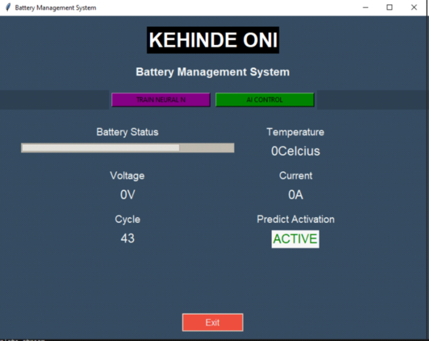

# Msc_Dissertation_Project

** AI-Based Battery Management System for 2/3-Wheeler Electric Vehicles **

MSc Computer Science Dissertation Project

Institution: York St John University
Academic Year: 2023–2024
Project Area: Artificial Intelligence, Machine Learning, Electric Vehicles and Battery Management

1. Project Overview

This project looks at the application of Artificial Intelligence (specifically neural network techniques) to battery management systems for two and three wheelers.

Battery management is a key element of EV technology. Good monitoring and analysis of the battery's operating state can lead to better battery utilisation, better performance monitoring and better informed battery management decisions.

The research looks at how neural network based approaches could be integrated into the proposed BMS, with the intent of showing the potential of AI in assisting with battery monitoring and analysis.

The project was part of an MSc in Computer Science dissertation at York St John University.

2. Research Objectives

The main objectives of the project were to:

* Look at the application of AI in EV battery management.
* Explore neural network techniques for battery analysis.
* Develop a proposed AI based battery management system.
* Implement a system interface to enable interaction with the proposed solution.
* Evaluate the implementation via simulation.
* Look at the potential and the limitations of applying AI techniques to battery management in the two and three wheelers.

3. Technical Approach

The project looked at the application of neural network techniques within an AI based battery management system.

The implementation brought the proposed system interface together with the underlying computational components to demonstrate the approach.

The project was assessed via simulation rather than on a real electric vehicle or actual commercial battery management hardware.

See the dissertation report and the source code files for the implementation.

4. Repository Structure

This repository contains the academic research materials and source code files associated with the MSc dissertation.

The repository includes:

* Dissertation Report / The MSc dissertation report.
* Research Proposal/ – The original research proposal.
* Source code files - the implementation components of the proposed BMS.
* Supporting files – further project materials and documentation.

5. Project Scope and Limitations

This is an academic R&D exercise.

The implementation was assessed via simulation. It must not be construed as a commercially deployed or physically validated EV battery management system.

Further work would be required to:

* Validate the approach using real world battery data.
* Test the implementation with actual battery hardware.
* Evaluate performance under a range of operating conditions.
* Investigate model accuracy, reliability and computational efficiency.
* Explore integration with practical battery management hardware.

These areas present opportunities for further R&D.

6. Academic Context

This was work completed as part of the MSc Computer Science at York St John University in 2024.

The repo contains the original dissertation implementation and all the associated academic material for reference and technical review.

The source code is the code that was actually submitted as part of the original project. The GitHub repo is there to provide an accessible presentation of that work.

7. Intended Audience

This repository may be useful to:

* Researchers looking at AI in the context of EVS.
* Students studying AI and machine learning.
* Developers in the battery management space.
* Individuals looking at the application of neural networks to engineering systems.

8. Disclaimer

This is an academic research prototype. It's not intended for use in any commercial EVS or indeed in any safety-critical battery management application.

No claim is made that the implementation has been validated for real-world battery operation.

9. Author

Kehinde Oni
MSc Computer Science
York St John University

GitHub: kennytoday